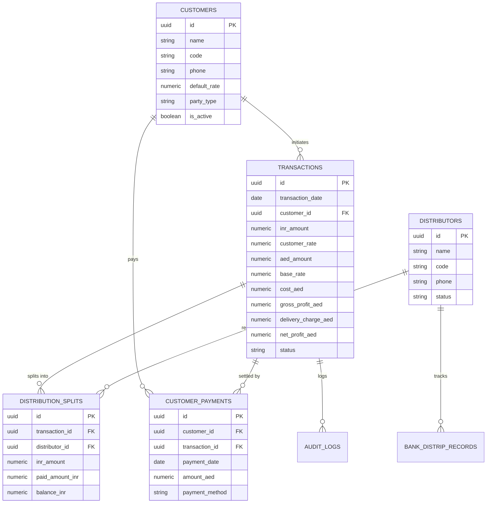

# Phase 5 — Entity Relationship Architecture & Reference Map

---

## Reference Integrity Guarantees

1. **Foreign Key Integrity:**
   - \`transactions.customer_id\` references \`customers.id\`.
   - \`distribution_splits.transaction_id\` references \`transactions.id\`.
   - \`distribution_splits.distributor_id\` references \`distributors.id\`.
   - \`customer_payments.transaction_id\` references \`transactions.id\`.
2. **Cascade Deletion Policy:**
   - When a \`transaction\` is deleted via \`deleteTransaction(id)\`, the database executes:
     1. \`DELETE FROM customer_payments WHERE transaction_id = $1\`
     2. \`DELETE FROM distribution_splits WHERE transaction_id = $1\`
     3. \`DELETE FROM audit_logs WHERE entity_id = $1\`
     4. \`DELETE FROM transactions WHERE id = $1\`
   - Zero orphaned payment or split rows can remain.
3. **Authentic Distribution Parties Constraint:**
   - Strictly 5 protected entities: \`MK\`, \`SALA\`, \`HAJA\`, \`SARAB\`, \`NF2\`. Spurious or test distributor entities are barred.
